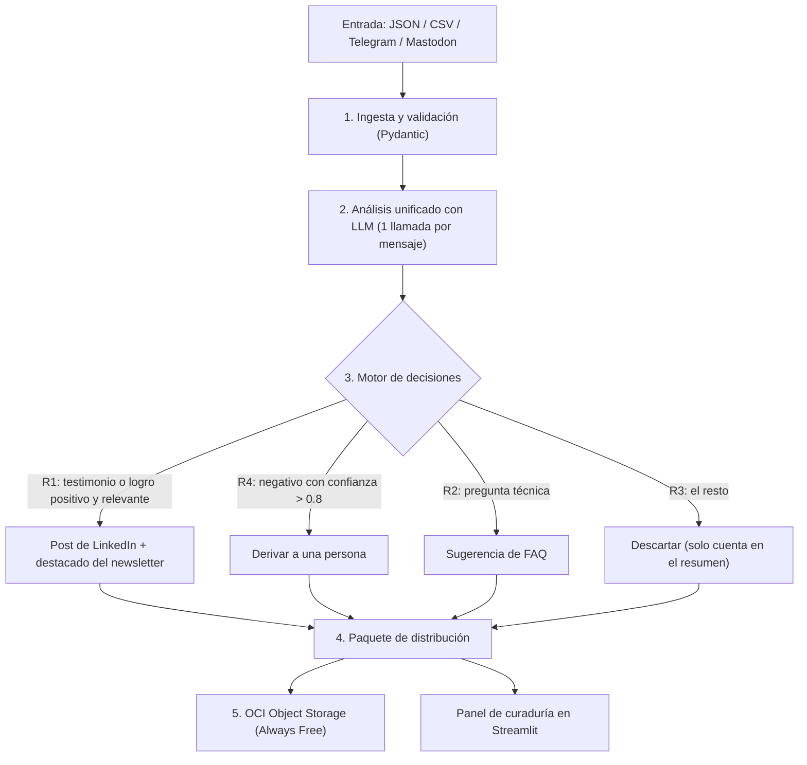

# 🚀 CommunityLab — Motor Inteligente de Transformación y Distribución para Comunidades Digitales

> **Hackathon ONE G10 — Oracle Next Education & Alura** · Equipo 24 · No Country
> Convierte la actividad orgánica de una comunidad digital en activos de marketing listos para publicar.

**Pruébalo en línea**

- 🖥️ Panel de curaduría (Streamlit Community Cloud): https://g10-latam-equipo24-communitylab-9kngbpffazuc5cwtjakwsr.streamlit.app/
- 🤖 Bot de Telegram: https://t.me/CommunityLabG10_bot
- 🎬 Video de la demostración: https://youtu.be/MO0ocl6fr2c

---

## 🎯 Qué resuelve

Los equipos de marketing y de gestión de comunidades pasan horas buscando, entre mensajes dispersos, testimonios espontáneos y dudas que valga la pena convertir en contenido. CommunityLab hace ese trabajo de forma automática:

- **Ingiere** interacciones en lote (JSON o CSV), desde un bot de Telegram con webhook y desde publicaciones de Mastodon.
- **Analiza** cada mensaje con un LLM en **una sola llamada**: sentimiento (3 clases), categoría y relevancia.
- **Decide** con un motor de reglas qué activo generar o si el mensaje necesita atención humana.
- **Genera** tres activos: post de LinkedIn, destacado del newsletter semanal y sugerencia de FAQ.
- **Persiste** el paquete de salida en **OCI Object Storage** (capa Always Free).
- **Presenta** todo en un panel de Streamlit para revisar, editar, aprobar y descargar.

La orquestación es un **pipeline de Python puro**, testeable etapa por etapa. El desafío admite n8n, LangChain, LangGraph **o equivalentes**; elegimos Python por simplicidad y para poder probar cada etapa de forma aislada (ver [arquitectura](docs/arquitectura.md)).

---

## ✅ Estado al 25/10/2026

| Módulo | Estado |
|---|---|
| Contrato de datos (modelos Pydantic) | ✅ Listo, protegido por `tests/test_contract.py` |
| Ingesta (JSON, CSV, Telegram con webhook, Mastodon) | ✅ Listo |
| Cliente LLM (Ollama Cloud/local, Gemini, OpenAI, `rule_based`) | ✅ Listo |
| Análisis unificado (sentimiento, categoría, relevancia) | ✅ Listo, con resultado neutro seguro si el LLM falla |
| Motor de decisiones (R1 → R4 → R2 → R3) | ✅ Listo |
| Generadores (LinkedIn, newsletter, FAQ) | ✅ Listo |
| Pipeline de punta a punta | ✅ Listo (`src/pipeline.py`) |
| OCI Object Storage | ✅ Listo, con `guardado_con_exito` y respaldo local |
| Panel de Streamlit | ✅ Publicado en Streamlit Community Cloud |
| Bot de Telegram | ✅ Webhook publicado en Render |
| Pruebas | ✅ 571 pruebas con pytest y flake8 en 0 (`main` = `cbc7161`, 25/10/2026) |

---

## 📐 Contrato de datos (innegociable)

El sistema consume y produce **exactamente** los JSON del desafío. Los modelos de `src/domain/models.py` reflejan el contrato 1:1. **Si tocas un campo, corre `pytest tests/test_contract.py`.**

### Entrada

```json
{
  "origen_comunidad": "Discord_Grupo_ONE_G10",
  "periodo_referencia": "Semana_04",
  "interacciones": [
    { "autor": "Mariana Souza", "canal": "#logros-y-empleos", "tipo": "testimonio", "texto": "..." },
    { "autor": "Lucas Albuquerque", "canal": "#dudas-langgraph", "tipo": "pregunta_tecnica", "texto": "..." }
  ]
}
```

> **Clave:** el campo `tipo` es la señal que decide qué activo generar. No se pierde ni se vuelve a inferir.

### Salida

```json
{
  "status": "exito",
  "resumen_comunidad": { "total_interacciones_procesadas": 2, "sentimiento_predominante": "...", "temas_principales": ["..."] },
  "activos_distribucion_generados": {
    "post_linkedin": { "titulo": "...", "copy": "...", "canal_recomendado": "...", "potencial_engagement": "..." },
    "destaque_newsletter_semanal": { "seccion": "...", "titular": "...", "resumen": "..." },
    "sugerencia_contenido_faq": { "tema": "...", "origen": "...", "status": "..." }
  },
  "almacenamiento_oci": { "bucket": "communitylab-activos-marketing", "ruta_objeto": "...", "status": "guardado_con_exito" }
}
```

Además de los campos del PDF, la salida agrega información útil para el panel (por ejemplo, `feedback_negativo`, `mensajes_derivados` y `temas_faq`) sin quitar ni renombrar ningún campo del contrato.

---

## 🏗️ Arquitectura



**Reglas y decisiones clave** (registradas en [docs/DECISIONS.md](docs/DECISIONS.md)):

- **Orden de las reglas R1 → R4 → R2 → R3** (D-I). Un mensaje negativo se deriva antes de evaluarse como FAQ, aunque sea una pregunta técnica.
- **R1** publica testimonios y logros positivos con relevancia ≥ 0.6. **R4** deriva solo si la confianza del sentimiento negativo es **mayor a 0.8** (0.8 exacto no deriva).
- Si el `tipo` de la entrada y la categoría del modelo difieren, **manda el `tipo`** cuando es reconocido (D-B).
- Un solo vocabulario de categorías: `testimonio`, `pregunta_tecnica`, `feedback`, `logro`, `discusion`, `otro` (D-C). `duda_tecnica` es alias de `pregunta_tecnica`.
- El sentimiento usa **3 clases** (D-G) y todo mensaje negativo se cuenta como `feedback_negativo` en el resumen (D-F).
- Ante un fallo del LLM, el analizador devuelve un resultado neutro seguro y **el pipeline nunca se cae**.

Más detalle: [arquitectura](docs/arquitectura.md), [flujo general del sistema](docs/arquitectura-tecnica/flujo-general-del-sistema.md) (versión sin tecnicismos) y [análisis de arquitectura](docs/arquitectura-tecnica/analisis-arquitectura.md).

---

## 📁 Estructura del proyecto

```
G10-Latam-Equipo24-CommunityLab/
├── src/
│   ├── domain/        # Modelos del contrato + interfaces
│   ├── ingest/        # JSON, CSV, normalizador, Mastodon, bot y webhook de Telegram
│   ├── utils/         # Cliente LLM común (ollama / gemini / openai / rule_based)
│   ├── analysis/      # Análisis unificado (sentimiento, categoría, relevancia)
│   ├── decisions/     # Motor de reglas R1 → R4 → R2 → R3
│   ├── prompts/       # Plantillas de prompts por canal
│   ├── generators/    # LinkedIn, newsletter, FAQ
│   ├── oci/           # Object Storage (cliente + respaldo local)
│   ├── interface/     # Panel de Streamlit, estado de curaduría, publicación en Telegram
│   └── pipeline.py    # Orquestador de punta a punta
├── scripts/           # run_demo.py, run_webhook.py, run_bot.py, generar_muestra.py…
├── tests/             # 571 pruebas (25/10/2026)
├── data/sample/       # Lotes de ejemplo y corrida completa con el modelo de la demo
├── docs/              # Documentación, decisiones, despliegue y pruebas
└── README.md
```

---

## 🚀 Cómo ejecutar

### 1. Instalación

```bash
python3 -m venv venv
source venv/bin/activate
pip install -r requirements.txt
```

### 2. Configuración

Copia `.env.example` a `.env` y elige el backend del modelo:

```bash
COMMUNITYLAB_LLM_BACKEND=ollama   # ollama | gemini | openai | rule_based
OLLAMA_MODEL=gemma4:31b           # modelo de la demo (Ollama Cloud)
```

> Sin credenciales, usa `COMMUNITYLAB_LLM_BACKEND=rule_based`: es determinista, no usa red ni tiene costo, y es el plan B de la demo.
> Los secretos (claves de API, llave privada de OCI) **nunca** se guardan en el repositorio: van en `.env` local o como secretos de cada plataforma. Ver [docs/oci-setup.md](docs/oci-setup.md).

### 3. Demo

```bash
python3 scripts/run_demo.py --offline   # sin red ni claves, determinista (plan B)
python3 scripts/run_demo.py             # en línea: Ollama Cloud + gemma4:31b
make run                                # panel de curaduría en http://localhost:8502
```

Salida esperada del modo `--offline`: termina con `Demo OK. Los activos listos para publicar quedaron arriba.` Detalle y solución de problemas en [docs/demo.md](docs/demo.md).

### 4. Pipeline con un lote propio

```bash
python3 -m src.pipeline data/sample/demo_fixed.json
```

### 5. Pruebas y lint

```bash
python3 -m pytest tests/ -q
flake8 src tests scripts
```

---

## ☁️ Despliegue

- **Panel**: Streamlit Community Cloud → [docs/deploy-streamlit-cloud.md](docs/deploy-streamlit-cloud.md)
- **Webhook del bot de Telegram**: Render, con un ping programado que lo mantiene despierto → [docs/deploy-render-webhook.md](docs/deploy-render-webhook.md)
- **Persistencia**: OCI Object Storage, bucket `communitylab-activos-marketing`, región `sa-valparaiso-1` → [docs/oci-setup.md](docs/oci-setup.md)
- Guía general: [docs/deploy.md](docs/deploy.md)

---

## 🧪 Evidencia frente al checklist del jurado

- [x] **Ingesta funcional** de interacciones (JSON, CSV, Telegram, Mastodon) — [docs/ingesta.md](docs/ingesta.md), [cobertura de ingesta](docs/pruebas/cobertura-ingesta-multicanal.md)
- [x] **Análisis de sentimiento y temas con LLM** — [docs/llm-pipeline.md](docs/llm-pipeline.md)
- [x] **Al menos 2 formatos de activos**: LinkedIn, newsletter y FAQ
- [x] **Orquestación** con un pipeline de Python — `src/pipeline.py`
- [x] **OCI Object Storage** con `guardado_con_exito` — [docs/oci-evidencia.md](docs/oci-evidencia.md)
- [x] **3+ ejemplos de transformación**: 5 casos reproducibles (testimonio → LinkedIn, logro → newsletter, duda → FAQ, feedback → descarte, reclamo → derivación) — [docs/pruebas/ejemplos-transformacion-r6.md](docs/pruebas/ejemplos-transformacion-r6.md)
- [x] **Repositorio con documentación y diagrama** — este README y [docs/](docs/)

**Corrida de referencia** (`data/sample/corrida-completa-gemma.json`, `gemma4:31b`): 232 interacciones procesadas; sentimiento 108 positivo, 87 neutral y 37 negativo; 4 mensajes derivados a una persona; 8 temas de FAQ; paquete guardado en OCI en `activos/2026-semana-43/paquete-distribucion.json`.

---

## 🔄 CI

- **[`ci.yml`](.github/workflows/ci.yml)**, en cada push y pull request: `pytest tests/ -v` y `flake8 src tests scripts` (configuración en [`.flake8`](.flake8)).
- **[`pr-validation.yml`](.github/workflows/pr-validation.yml)**, en cada pull request: exige exactamente una etiqueta `type:*` (`type:bug`, `type:feature`, `type:docs`, `type:refactor`, `type:chore`), que se asigna sola a partir del prefijo del título.
- Detalle: [docs/pipeline-ci.md](docs/pipeline-ci.md)

---

## ⚠️ Limitaciones conocidas

- El plan gratuito de Render duerme el servicio tras un rato sin tráfico; el primer mensaje al bot puede tardar cerca de un minuto.
- No se pudo crear la máquina virtual de OCI por falta de capacidad en la capa gratuita. Por eso el despliegue usa Render y Streamlit Community Cloud, y OCI Object Storage queda para la persistencia.
- La marca de "atendido" puede pisarse si dos operadores trabajan el mismo lote al mismo tiempo.
- Trabajo futuro: responder de inmediato al webhook y procesar en segundo plano; límite de tasa y lista de usuarios permitidos para el bot.

---

## 📚 Documentación

- **Arquitectura y decisiones**: [arquitectura](docs/arquitectura.md) · [arquitectura técnica](docs/arquitectura-tecnica/) · [registro de decisiones](docs/DECISIONS.md) · [decisiones del contrato](docs/decisiones-contrato.md) · [decisión DERIVAR](docs/decision-derivar.md)
- **Despliegue y OCI**: [deploy](docs/deploy.md) · [Streamlit Cloud](docs/deploy-streamlit-cloud.md) · [Render](docs/deploy-render-webhook.md) · [OCI setup](docs/oci-setup.md) · [evidencia OCI](docs/oci-evidencia.md)
- **Datos, LLM y pruebas**: [análisis de datasets](docs/analisis_datasets.md) · [ingesta](docs/ingesta.md) · [pipeline LLM](docs/llm-pipeline.md) · [pruebas](docs/pruebas/)
- **UX y gestión**: [UI design](docs/ui-design.md) · [mockups](docs/mockups/README.md) · [demo](docs/demo.md) · [fichas de historias de usuario](docs/fichas-historias-usuario.md) · [checklist de review](docs/review-checklist.md)
- **Contribución**: [CONTRIBUTING.md](CONTRIBUTING.md) · [flujo de Git](docs/git-workflow.md)

---

## 👥 Equipo

Equipo voluntario de varios países. Cada cambio llegó por pull request con CI en verde y la aprobación de un code owner distinto del autor.

| Integrante | Módulos |
|---|---|
| `Rox-0864` | Contrato, análisis unificado, pipeline, revisión de código |
| `emanuelperacchia` | Git, CI, OCI, prompts, despliegue |
| `Elias-J-Guardado` | Ingesta |
| `Yis-ai-eng` | Generadores y motor de decisiones |
| `mrolon09` | Interfaz en Streamlit |
| `itanflores` | QA, verificación y documentación |

---

*Proyecto del Hackathon ONE G10 — Oracle Next Education & Alura*
