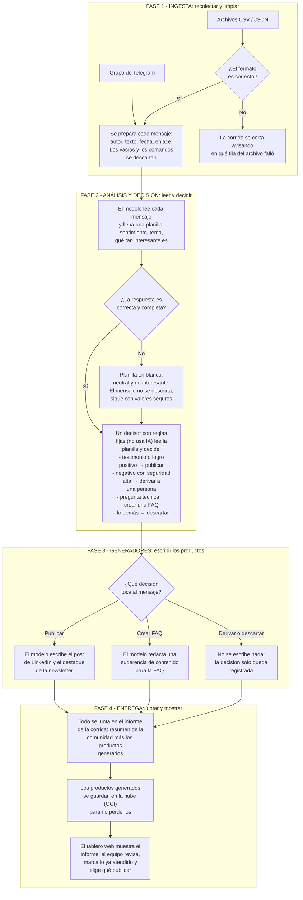

# Flujo general del sistema

Este documento describe, en cuatro fases, el recorrido completo de un mensaje
desde que entra a la comunidad hasta que aparece en el tablero web.

## Diagrama general

## Fase 1: Ingesta (recolectar y limpiar)

Los mensajes llegan por dos puertas:

- **Telegram**: los mensajes del grupo se recogen en vivo (Telegram los empuja
  al sistema apenas llegan, mediante un webhook) o de a ratos (el sistema
  pregunta cada tanto si hay mensajes nuevos).
- **Archivos**: el equipo sube archivos CSV o JSON con mensajes recolectados.

Antes de gastar análisis, se descartan los mensajes vacíos y los comandos
internos del grupo (los que empiezan con barras, como `/start`). Si un archivo
trae errores de formato, la corrida corta en ese punto indicando la fila
exacta, para que el equipo corrija y vuelva a intentar.

## Fase 2: Análisis y decisión (leer y decidir)

El modelo de lenguaje es intercambiable por configuración: puede ser **Gemini**
en la nube (pide una clave) o un **modelo abierto servido por Ollama**, que
corre en la máquina o en la nube. Si no se configura ninguno, el análisis se
hace con reglas fijas, sin inteligencia artificial. Ese modelo **no escribe
nada todavía**: solo lee y clasifica. Por cada mensaje llena una planilla con
tres campos:

1. **Sentimiento**: positivo, negativo o neutro, con un puntaje de seguridad.
2. **Tema**: testimonio, pregunta técnica, feedback, logro o discusión.
3. **Interés**: un puntaje de cero a uno que indica si el mensaje vale la pena
   publicar.

Si el modelo falla, responde mal o devuelve categorías desconocidas, la
planilla queda con valores seguros (neutral, sin tema conocido, sin interés)
y el proceso sigue con el siguiente mensaje: **ninguna falla detiene la
corrida**.

Después de la planilla, un **decisor por reglas fijas** — que no usa
inteligencia artificial, por eso sus decisiones siempre resultan iguales —
aplica las reglas de negocio en este orden:

- Testimonio o logro **positivo** con interés suficiente → **publicar**.
- Mensaje **negativo** con una seguridad mayor al 80% → **derivar** al
  community manager para atención personalizada.
- **Pregunta técnica** → **crear una FAQ**.
- Todo lo demás → **descartar**.

## Fase 3: Generadores (escribir los productos)

Solo los mensajes elegidos en la fase anterior hacen una **segunda** llamada al
modelo, esta vez sí para escribir:

- El **post de LinkedIn** y el **destaque de la newsletter** salen del
  testimonio o logro positivo que se decidió publicar.
- La **sugerencia de FAQ** sale de la pregunta técnica elegida.
- Lo derivado se clasifica de acuerdo a su reelevancia y selecciona los de >0.8 y los deriva para atencion humana (Community Manager).

Si la escritura de un producto falla, ese producto simplemente no se incluye y
la corrida sigue: nunca se bloquea todo por un solo intento.

## Fase 4: Entrega (juntar y mostrar)

La corrida junta todo en un informe único: el resumen de la comunidad y los
productos generados.

- Los **productos generados** (post de LinkedIn, newsletter, FAQ) se **guardan
  en la nube** (almacenamiento OCI) para no perderlos y poder consultarlos
  después.
- El informe se **muestra en el tablero web**, donde el equipo revisa los
  productos, marca qué derivados ya fueron atendidos y elige qué publicar.

El tablero también puede cargar una corrida ya guardada (como la muestra de
ejemplo del proyecto) sin volver a analizar nada.

## Cómo ver el diagrama

El diagrama de arriba se dibuja automáticamente en GitHub al pegar este
archivo (GitHub interpreta los bloques `mermaid` sin configurar nada). También
puede previsualizarse en [mermaid.live](https://mermaid.live) o en VS Code con
la extensión "Markdown Preview Mermaid Support".
