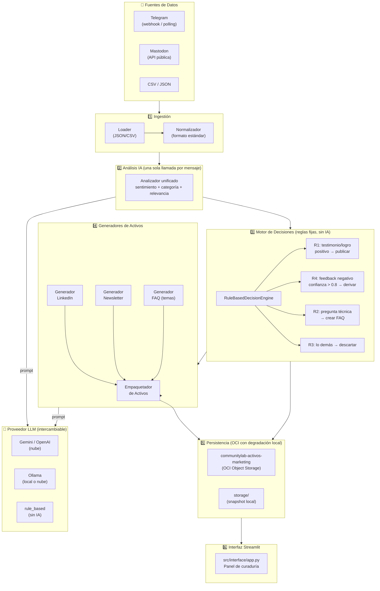
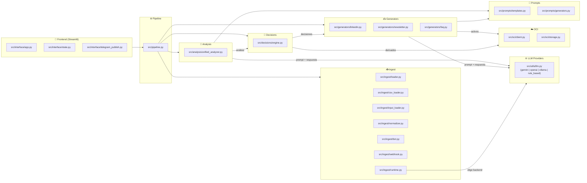
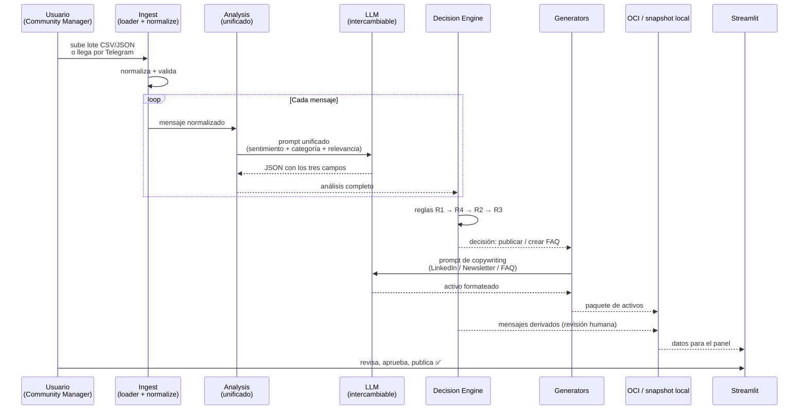
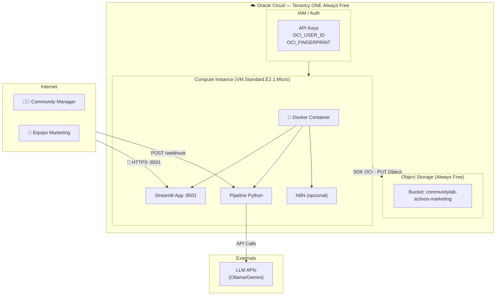
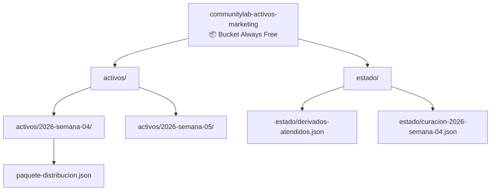
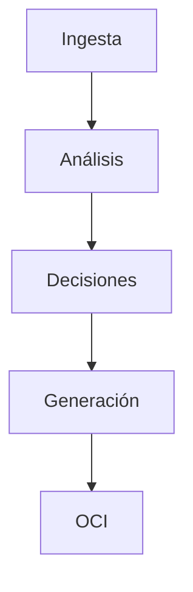

# 🏗️ ARQUITECTURA — CommunityLab

> Diagramas en Mermaid, listos para incrustar en el README.md del repositorio.
> Usar con GitHub (soporta Mermaid nativo) o renderizar en mermaid.live.

---

## 📐 DIAGRAMA 1: VISTA GENERAL DEL PIPELINE (para el README principal)



---

## 🧩 DIAGRAMA 2: COMPONENTES DETALLADOS (para docs/architecture.md)



---

## 🔄 DIAGRAMA 3: FLUJO DE DATOS TÉCNICO (JSON in → JSON out)



---

## 🏛️ DIAGRAMA 4: DESPLIEGUE (SI usan OCI Compute — opcional/diferencial)



---

## 📊 DIAGRAMA 5: BUCKET OCI — Estructura de objetos



> Nota: sin credenciales OCI, el pipeline degrada a un snapshot local bajo
> `storage/activos/` y `storage/estado/` (mismas claves, espejo local).

---

## 📋 INSTRUCCIONES DE USO EN EL README

### Para GitHub (render nativo):
```markdown

```

GitHub renderiza Mermaid automáticamente en Markdown desde 2025.

### Para la presentación ejecutiva:
Exportar desde:
- [mermaid.live](https://mermaid.live) → PNG/SVG de alta calidad
- O usar [Mermaid Ink](https://mermaid.ink) para generar URLs de imágenes

### Alternativa offline (sin Mermaid):
Generar el diagrama con **draw.io** (free) usando los mismos componentes. La versión Mermaid es el estándar recomendado.

---

## 🎯 Decisiones de arquitectura

Las decisiones (orquestación, LLM, interfaz, persistencia, módulo de decisiones, deploy) y su justificación viven en **[`DECISIONS.md`](DECISIONS.md)** — única fuente de verdad. Acá no se duplican.

---

*Arquitectura creada para equipo CommunityLab — Oracle ONE Hackathon G10*
*Los diagramas 1-5 están listos para pegar en los documentos del repo.*