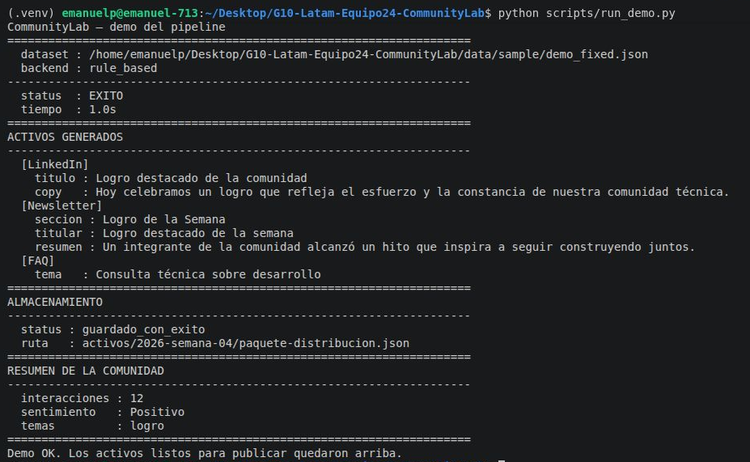
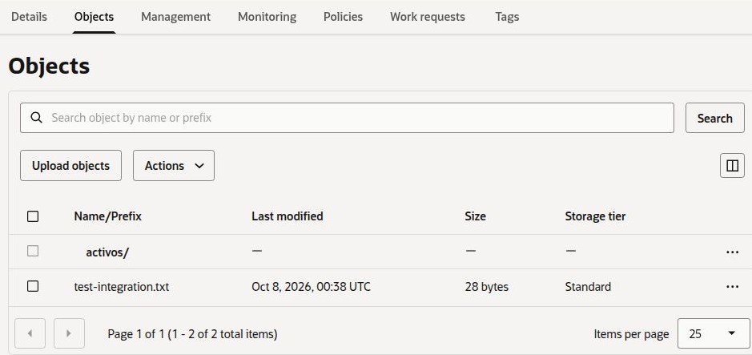
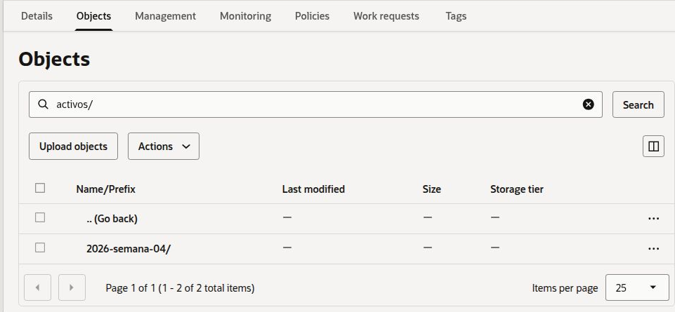
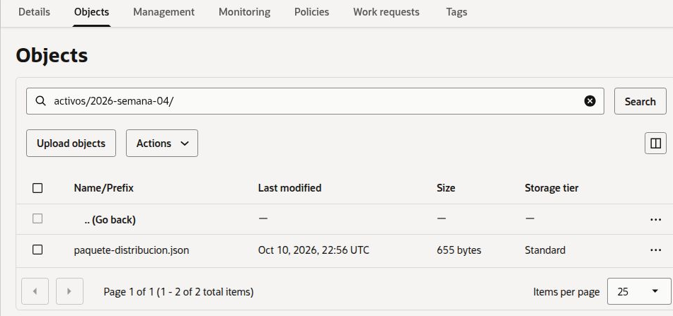

# ☁️ Evidencia de Integración con OCI Object Storage (Requisito R5)

> **Autor:** @emanuelperacchia  
> **Fecha de validación:** Octubre 2026  
> **Estado:** ✅ Conectividad y subida del pipeline verificadas en capa Always Free (`sa-valparaiso-1`)

---

## 1. Resumen de Infraestructura Configurada
- **Tenancy / Cuenta:** Activa en Oracle Cloud Infrastructure (Región `sa-valparaiso-1`).
- **Compartimiento:** `com-proyecto-comunitylab` (Hijo del proyecto principal).
- **VCN:** `vcn-communitylab` (Bloque CIDR: `10.0.0.0/16`).
- **Subredes:** 
  - Pública (`public-subnet`) con DNS label `public`.
  - Privada (`private-subnet`) con DNS label `private`.
- **Object Storage Bucket:** `communitylab-activos-marketing` (Visibilidad: Privada, Cifrado con claves administradas por Oracle).

---

## 2. Validación de Conectividad y Permisos (Script de Prueba)

Para demostrar que la aplicación se comunica de forma exitosa con el bucket OCI utilizando las credenciales de API Key y la llave privada `.pem`, se ejecutó el comando de prueba de almacenamiento:

```bash
python -c "from src.oci.storage import OCIStorage; print(OCIStorage().test_connection_and_upload('communitylab-activos-marketing'))"
```

### Output obtenido (Evidencia de éxito):
```python
(True, "Successfully connected to bucket 'communitylab-activos-marketing' and uploaded file 'test-integration.txt'.")
```

---

## 3. Comprobación en la Consola de OCI
Al ingresar a la OCI Console en **Object Storage → Buckets → communitylab-activos-marketing**, se constata la presencia del archivo `test-integration.txt` generado automáticamente por el script de prueba, confirmando que las operaciones de lectura y escritura (`GET` y `PUT`) funcionan sin fricciones.

---

## Evidencia de subida del pipeline (R5)

Se ejecutó el pipeline completo con `python scripts/run_demo.py` con las credenciales OCI cargadas en `.env`. El almacenamiento devolvió `guardado_con_exito` y el paquete quedó subido al bucket `communitylab-activos-marketing`.

- **Fecha de la corrida:** 10/10/2026
- **Entorno:** Lubuntu, Python 3.12 en entorno virtual (`.venv`)
- **Backend de análisis:** `rule_based` (corrida sin LLM externo; el backend se elige con `COMMUNITYLAB_LLM_BACKEND`)
- **Dataset:** `data/sample/demo_fixed.json` (12 interacciones)
- **Estado del pipeline:** `exito`
- **Estado del almacenamiento:** `guardado_con_exito`
- **Ruta del objeto:** `activos/2026-semana-04/paquete-distribucion.json`

### 1. Salida de la terminal



### 2. Bucket en la consola de OCI

Raíz del bucket, con el prefijo `activos/` creado por el pipeline y el objeto `test-integration.txt` de la prueba de conectividad previa:



Prefijo `activos/` con la carpeta de la corrida:



Objeto subido por el pipeline (655 bytes, 10/10/2026 22:56 UTC):



### Reproducción

1. Cargar las credenciales OCI en `.env` (ver `.env.example`).
2. Activar el entorno virtual e instalar `requirements.txt`.
3. Ejecutar `python scripts/run_demo.py`.
4. Verificar `status : guardado_con_exito` en la sección ALMACENAMIENTO y el objeto en el bucket.
---
*Documento generado como evidencia técnica para el equipo de desarrollo y validación del QA.*
