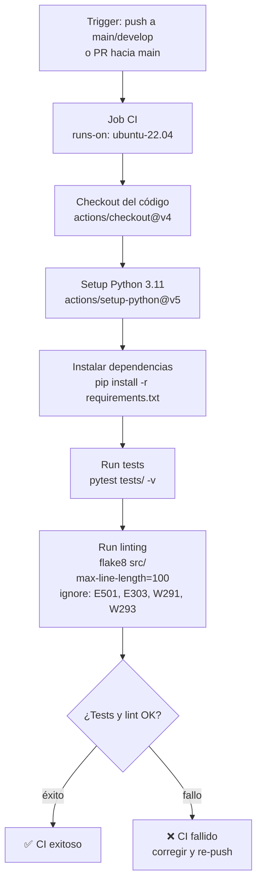

# CI Pipeline

Pipeline de integración continua definido en `.github/workflows/ci.yml`.

## Diagrama de flujo

## Detalles

| Paso | Herramienta | Configuración |
|---|---|---|
| Trigger | GitHub Actions | `push` a `main`/`develop`, `pull_request` a `main` |
| Runner | ubuntu-22.04 | — |
| Test | pytest | `pytest tests/ -v` |
| Lint | flake8 | `--max-line-length=100 --ignore=E501,E303,W291,W293` |

> **Nota:** GitHub renderiza Mermaid automáticamente en cualquier `.md` del repo. Para previsualizar localmente, usar VS Code con la extensión *Markdown Preview Mermaid Support* o [mermaid.live](https://mermaid.live).
